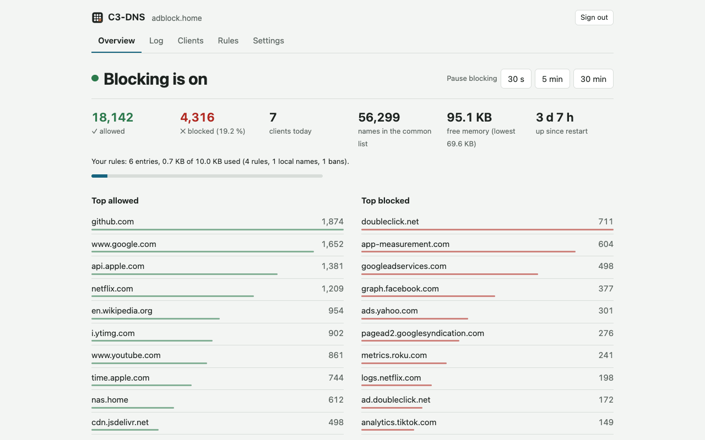
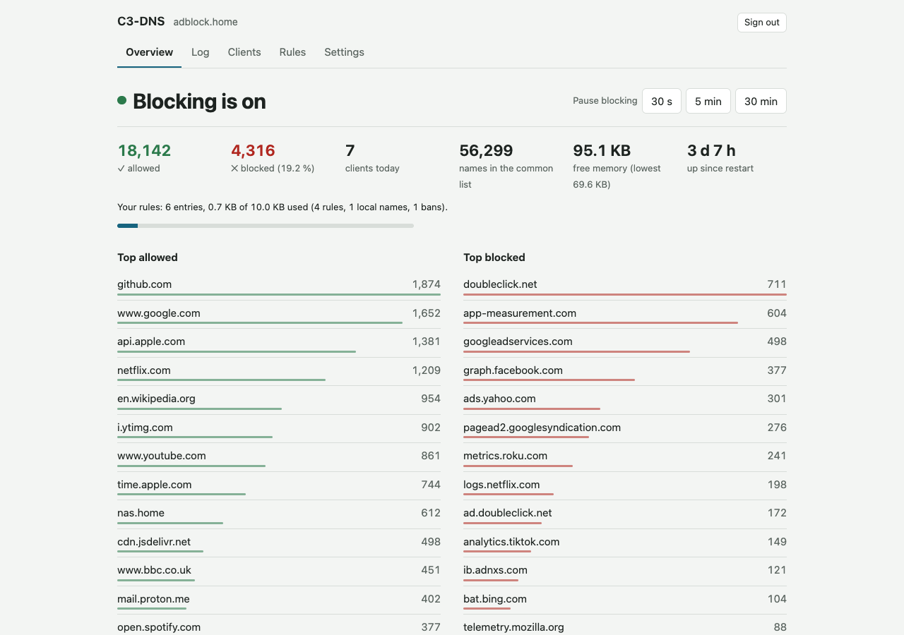
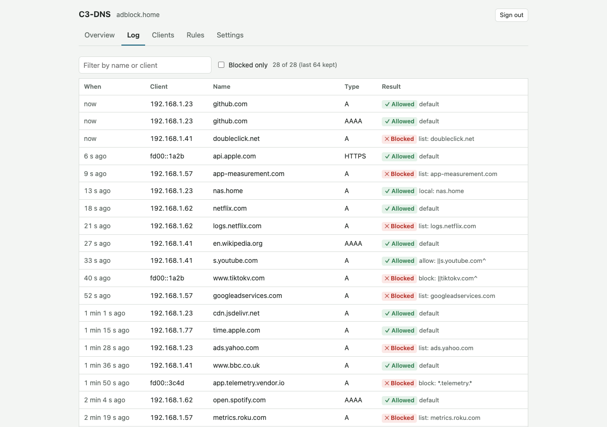
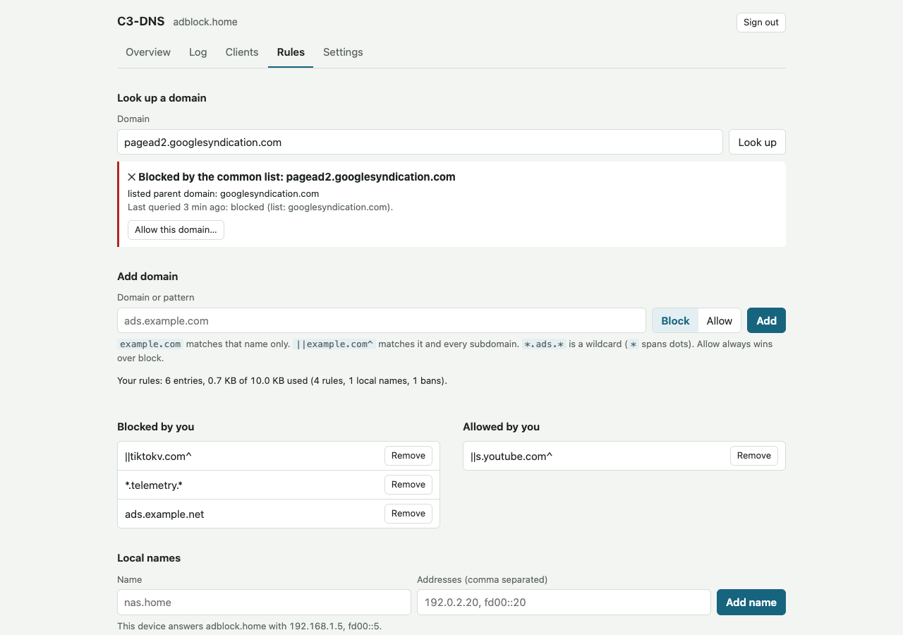
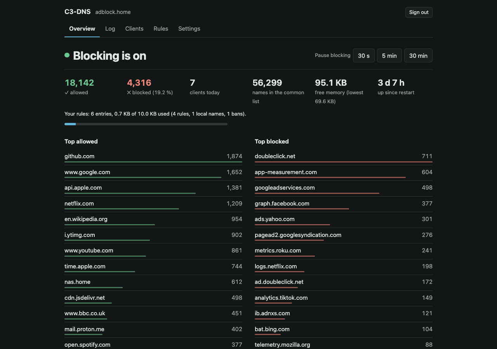
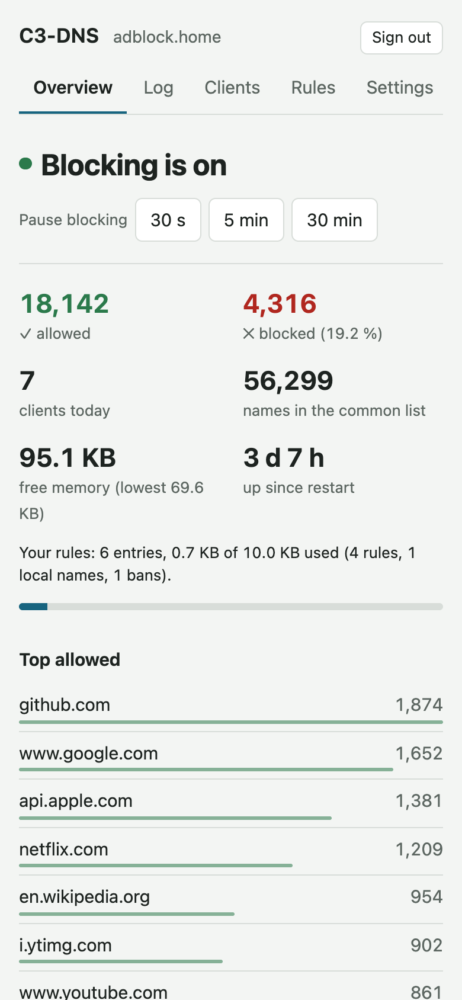

# C3-DNS

**A network-wide ad blocker on a $3 ESP32-C3, written in Rust.** No Raspberry Pi, no SD card,
no OS to patch: a thumb-sized board that answers your home's DNS, blocks ads and trackers, and
shows you what every device on your network is looking up.

[](https://github.com/shivashishrs/c3-dns/actions/workflows/ci.yml)
[](https://github.com/shivashishrs/c3-dns/releases)
[](LICENSE)

**[Install from your browser →](https://shivashishrs.github.io/c3-dns/)** (Chrome or Edge, about a minute, no toolchain)



## Why

- **Cheap and tiny.** Any ESP32-C3 board with 4 MB flash; no PSRAM needed. Power it from
  any USB port or phone charger.
- **Big list, small RAM.** The blocklist lives in flash as sorted 40-bit hashes and is
  binary-searched in place, so a list of up to ~400,000 domains costs no RAM.
- **See what's happening.** A small web UI shows queries live, top allowed and blocked domains,
  per-device activity and daily history.
- **Built not to take your internet down.** Bad storage falls back to defaults with a
  warning; the device keeps answering DNS ahead of everything else; it refuses to be an open
  resolver.

## Features

**Blocking**
- Blocklist in its own flash partition with room for ~400,000 domains; parent domains match
  (listing `ads.example` also blocks `x.ads.example`). Releases ship StevenBlack's list.
- Your own rules in the web UI: exact names, a domain and all its subdomains, and `*`
  wildcards. Allow always wins. Rules, local names and bans share a 10 KB memory budget
  (about 90 typical rules); the UI shows how much is used.
- Blocked names get `0.0.0.0` / `::`, so apps fail fast instead of timing out.
- **CNAME uncloaking:** a tracker hidden behind an innocent-looking CNAME is still blocked.
- **Pause** blocking for 30 s, 5 min or 30 min from the UI.
- **Ban a device:** stop answering one client entirely.

**Resolving**
- A and AAAA over UDP, TCP for truncated answers, IPv4 and IPv6 clients.
- Upstreams Quad9 and Cloudflare by default (IPv4 and IPv6), with failover; change them in
  the UI.
- Answer cache with serve-stale, so a short upstream outage goes unnoticed.
- **Local names:** `nas.home` → `192.168.1.10`, up to 100 records. The device answers to
  `adblock.home` and to `adblock.local` over mDNS.
- Answers only clients on its own LAN (never an open resolver), with per-client and
  global rate limits.

**Seeing**
- Live query log with filter, top allowed and blocked domains, per-device counts.
- Daily summaries for the last 7 days, kept across reboots along with rules and settings.
- Look up any name to see whether it would be blocked and why (list, rule or parent domain).

**Setup and safety**
- Browser installer; Wi-Fi and the admin password are set from a phone through a setup
  portal; nothing is compiled in.
- Password stored as salted PBKDF2-HMAC-SHA256; login rate limits and lockout.
- Settings are saved into a ring of flash sectors (writes spread across 512 KB, CRC-checked);
  a power cut mid-save keeps the previous save, and damaged storage falls back to defaults
  with a warning instead of taking DNS down.

## What you need

- An **ESP32-C3 board with 4 MB flash** and a USB port (boards with the C3's built-in USB,
  such as the common "SuperMini", need no driver).
- A USB cable and a computer with Chrome or Edge for the first install.
- A router where you can set the DNS server handed out by DHCP.

It has been tested on one ESP32-C3 board (chip revision 0.4, 4 MB flash). If it works on yours,
please [file a board report](https://github.com/shivashishrs/c3-dns/issues/new?template=board-report.yml).

## Install

1. Open the **[web installer](https://shivashishrs.github.io/c3-dns/)**, plug in the board and
   press **Install**. On a first install choose **Erase device**.
2. On a phone, join the open Wi-Fi network **C3-DNS-XXXX**. The setup page opens (or go to
   `http://192.168.4.1/`). Pick your Wi-Fi and set an admin password (12+ characters).
3. The board restarts and joins your network. Open **`http://adblock.local/`** and sign in as
   `admin`.
4. Give the board a fixed address in your router (DHCP reservation), then set that address
   as the DNS server your router hands out. Check it from any device:
   `nslookup doubleclick.net <board-ip>` answers `0.0.0.0`.

Holding **BOOT** for 5 seconds clears Wi-Fi and the password and restarts into setup.
Updating through the web installer **without** erasing keeps your settings and rules.

<details>
<summary>Install without the web installer (espflash / esptool)</summary>

Download the images from the [latest release](https://github.com/shivashishrs/c3-dns/releases/latest).

First install (one file, erases settings):

```sh
espflash write-bin 0x0 c3-dns-full-4mb.bin
# or: esptool.py --chip esp32c3 write_flash 0x0 c3-dns-full-4mb.bin
```

Update, keeping Wi-Fi, password, rules and history:

```sh
esptool.py --chip esp32c3 write_flash \
  0x0 bootloader.bin 0x8000 partition-table.bin 0x10000 c3-dns.bin 0x210000 blocklist.bin
```

</details>

## Screenshots

| Overview | Query log | Rules |
|---|---|---|
|  |  |  |

| Dark mode | Phone |
|---|---|
|  |  |

Screenshots use made-up data.

## Blocklist

Releases ship [StevenBlack's unified hosts list](https://github.com/StevenBlack/hosts)
(adware and malware, about 56,000 domains). Add your own block and allow rules in the web UI
(allow always wins), or build a bigger image from any hosts files and domain lists, such as
[Hagezi's](https://github.com/hagezi/dns-blocklists):

```sh
cd dnscore
cargo run --release --example build_blocklist -- ../my-list.bin hosts light-onlydomains.txt
```

Then flash it with `tools/flash-blocklist.sh my-list.bin` (see [building](docs/building.md)).
The format is the same as esp32-c3-adblock's, so an existing `blocklist.bin` from that project
works too.

## Limits

Read these before you rely on it:

- **Plain HTTP on your LAN.** The admin UI uses Basic auth without TLS; anyone who can sniff
  your LAN traffic can see the password. Use a password you use nowhere else.
- **The setup Wi-Fi is open** for up to 15 minutes after the first boot or a BOOT hold.
  Anyone in radio range during that window could set the device up.
- **No DoH/DoT, no DNSSEC validation, no DHCP server, no regex rules, no OTA updates**
  (update over USB).
- One request at a time on the web UI; very slow clients can delay it for a few seconds.
- **Not yet verified on hardware:** a physical BOOT-button reset (the same code path was
  tested another way), and the setup page popping up by itself on iOS and Android.

Full details in [SECURITY.md](SECURITY.md) and the [design notes](docs/design.md).

## How it works

```
client ──UDP/TCP 53──▶ C3-DNS ──▶ your rules (allow wins) ──▶ blocklist (hashes in flash)
                          │                                        │
                          │◀── 0.0.0.0 / :: if blocked ◀───────────┘
                          └──▶ cache ──miss──▶ upstream resolvers (failover, serve-stale)
```

Logic lives in [`dnscore/`](dnscore), a plain Rust crate tested on your computer
(`cargo test`); [`firmware/`](firmware) is a thin layer over ESP-IDF. More in
[docs/design.md](docs/design.md).

## Build from source

See [docs/building.md](docs/building.md). In short: install the `esp` Rust toolchain with
`espup`, then `cd firmware && cargo build --release`.

## Moving from esp32-c3-adblock

See [docs/migrating-from-esp32-c3-adblock.md](docs/migrating-from-esp32-c3-adblock.md).

## Contributing

Issues, board reports and pull requests are welcome; see [CONTRIBUTING.md](CONTRIBUTING.md).
Security issues: [SECURITY.md](SECURITY.md).

## License

[MIT](LICENSE).

## Credits and inspiration

- **[esp32-c3-adblock](https://github.com/M-Abozaid/esp32-c3-adblock)** by M-Abozaid (MIT):
  the project that inspired this one. Its idea of keeping the blocklist as sorted 40-bit hashes
  in flash, its blocklist format and its list builder (ported to Rust here) are the core of
  C3-DNS's blocking.
- **[Pi-hole](https://pi-hole.net)**: the idea of a network-wide DNS sinkhole with a dashboard.
- **[StevenBlack/hosts](https://github.com/StevenBlack/hosts)** (MIT): the blocklist shipped in
  releases. **[Hagezi DNS blocklists](https://github.com/hagezi/dns-blocklists)** (GPL-3.0):
  recommended for a larger list you build yourself.
- **[esp-rs](https://github.com/esp-rs)**: `esp-idf-svc`, `espup` and `espflash`, which make
  Rust on the ESP32 practical, and Espressif's **[ESP-IDF](https://github.com/espressif/esp-idf)**.
- **[ESP Web Tools](https://esphome.github.io/esp-web-tools/)** by ESPHome: the browser
  installer.
